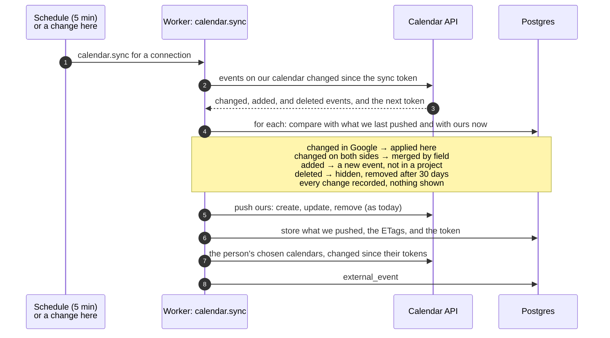

# Design: two-way Google Calendar

**Status:** Built (2026-10-20), except Google's change notices (branch 4 below), which need the deployed address. It changes [decision 0009](../decisions/0009-google-calendar-sync.md): phase 3, edits made in Google coming back, starts now instead of waiting. Why: [decision 0017](../decisions/0017-two-way-google-calendar.md). How a push works today: [system map](../system-map.md#google-calendar-today-and-later).

## The point

Today the calendar goes one way. Our events are pushed to a calendar we create in the person's Google account, and anything changed there is put back by the next push. People expect two-way sync from tools whose events live in their calendar (Motion, Reclaim, HubSpot): move a show in Google, and it moves here too.

This design reads our calendar back and brings what changed in Google into our events. It also moves reading the person's other calendars (phase 2) into the worker, so both stay current whether or not anyone has the Calendar screen open.

**Kept simple on screen.** A change made on either side just appears on the other. There's no change history, no Undo, no conflict notice, and no Restore. People don't remember which field they changed where, and showing it would confuse more than help. What protects the data happens out of sight (below), so Restore or a history can be added later without losing anything in the meantime.

## Decisions

| # | Question | Decision |
|---|---|---|
| 1 | An event edited or deleted in Google | **The edit appears here. The delete removes it from every screen here.** Nothing asks, and nothing is shown. |
| 2 | Changed in both places before they sync | **Merged silently, field by field**, so both people's changes survive: a field changed on one side takes that side's value, and a field changed on both takes the most recent. Nothing is shown. |
| 3 | Which fields come back | **Title, date, time, and end; the location where it's a single field** (shows, meetings); **notes**, from below a marked line in the description. Times come back as the same moment, in the event's own zone; a new event from Google takes the workspace's zone. Google's screen attaches the viewer's zone (the Google account's) to what it saves, so that zone is never taken. Composed fields stay ours: a travel route, a stay's hotel and address, and the description's project, operator, and seat lines. A change to one of those in Google is replaced by ours at the next sync, as today. |
| 4 | An event added in Google to our calendar | **It appears here right away, without a project**, marked simply as not in a project, and can be added to one from the Calendar screen. |
| 5 | How quickly Google's changes come back | **Every 5 minutes from the worker now; Google's change notices once deployed**, with a 30-minute read as the safety net. |
| 6 | An end for shows and meetings | **An end changed in Google comes back for every event.** Every kind can already have an end here (the planner and the event form; an ordinary event's end is in its start zone). With none, it goes to Google as one hour. |
| 7 | A repeating event added in Google | **Shown read-only**, like the person's other Google calendars: every occurrence in the window, edited in Google. **It can be added to a project as a whole series** (a weekly rehearsal for a show): every occurrence then shows the project. Unfiled, each occurrence carries "Not in a project" with Add to a project. Only for series in our own Talent Biz OS calendar; the person's other calendars stay personal (decision 0009). |
| 8 | Adding an event to a project | **All the talent's open projects, with the matched one first**, marked "Suggested", when one is clear. The match runs in code: an invited address matching a contact on exactly one project first, then exactly one project whose name, counterparty, or organization is in the title. Otherwise none: no guessing by date. Worked out when the event comes in from Google (with who was invited) and stored; for an event without a project made here, a name in its title. No reason text. Invited addresses are read for this match only, never stored. |

Out of sight, and kept so that Restore or a history can be added later:

- **The merge.** Without it, one person's edit would quietly disappear when two people change the same event.
- **A record of every change**, in `audit_log`, never shown for now. It answers "why did my show move?" for support.
- **A delete from Google hides the event, and keeps it for 30 days** before removing it for good. An accidental swipe on a phone can still be recovered by asking.

Defaults, settled without a separate decision:

- **Teammates.** Each person who connects has their own copy of the talent's calendar. An edit in anyone's copy changes the shared event here, and the next push updates every other copy.
- **Repeating.** If one of our events is made to repeat in Google, only its first occurrence is kept here. The app has no repeating events.
- **No new permission.** `calendar.app.created` already covers reading the events on calendars this app created, so nobody has to reconnect. To confirm against Google's documentation in branch 1.
- **No loops.** An event whose ETag matches the one we stored is unchanged, so our own writes never read back as changes from Google.
- **Who did it.** A change read from a connection is recorded as that person's, from Google Calendar. With a shared calendar it may have been someone they gave access to.

## A sync, both ways

One job per connection does both directions in order, on the connection's own queue, so a read and a push never race.



A sync token that's too old (Google answers 410) means a full read of our calendar. Events are matched to ours by the id we tag them with (`extendedProperties.private.talentBizOsId`), and the merge runs as usual.

## The merge

The merge compares three versions of each synced field:

- **Base:** what we last pushed. A new `pushed` snapshot on `calendar_event_sync`, in the form both sides share.
- **Ours:** the event here now.
- **Theirs:** the Google event, read back into the same form.

| Ours vs base | Theirs vs base | Result |
|---|---|---|
| same | same | nothing |
| changed | same | push ours (today's behavior) |
| same | changed | apply theirs here |
| changed | changed, to the same value | nothing to do |
| changed | changed, differently | the newer wins (Google's `updated` against our `updated_at`) |

Every applied change is recorded in `audit_log`, and nothing is shown.

- **A composed field changed in Google** (a travel route, a hotel, the lines above the notes marker) is never applied. The push puts ours back.
- **Times:** Google's start and end are read back as the same moment, as wall time in the event's own zone (decision 0003: a Tokyo show stays a Tokyo show), or in the workspace's zone for an event added in Google. The zone Google's screen attached (the viewer's) is never taken. A time without an offset is wall time in the zone Google names beside it. A date with no time is all-day.
- **Ends:** the end Google gives is kept. A timed event without an end lasts an hour, as we push it, so an end of exactly that hour and no end count as the same.
- **Notes:** the description is laid out as below. Only the text under the marked line comes back. The line is written in the person's language and recognized in either.

```
Project: Haoshi Winter Festival
Taipei → Tokyo · BR198 · 12A
── Notes (synced with Talent Biz OS) ──
Bring the in-ear monitors
```

- **Events pushed before this ships** have no snapshot. If an event hasn't changed here since its last push, its base is what we'd push now. Otherwise ours wins once, as today, and the snapshot starts from that push.

## Data

| Table | Change |
|---|---|
| `calendar_connection` | `sync_token`: where reading our calendar continues. Later, for change notices: `channel_id`, `channel_resource_id`, `channel_expires_at`. |
| `calendar_import_source` | `sync_token`: for each chosen calendar, only to tell cheaply *whether* it changed: Google doesn't allow a sync token together with a date window. The window is re-read when it changed, or once a day as it moves on. An `own` flag for one row per connection: our own calendar's repeating events, stored in `external_event` like a chosen calendar's, and shown read-only the same way. |
| `external_event` | `series_id`: for our own calendar's occurrences, the series they belong to (Google's `recurringEventId`). |
| `calendar_series_project` (new) | A series in our own calendar added to a project, by connection and series: every occurrence shows the project. |
| `calendar_event_sync` | `pushed` (jsonb): the synced fields as last written or read: the merge's base. "Newer" compares Google's `updated`, read with each change, against our `updated_at`. |
| `calendar_event` | `deleted_in_google_at`: hidden from every screen while set. Deleted for good 30 days later. `suggested_project_id`: the project an event added in Google most likely belongs to. |
| `audit_log` | New actions, recorded and not shown for now: `calendar_event.changed_in_google`, `.added_in_google`, `.deleted_in_google`, each with `{ connectionId, fields: { name: { from, to } } }`, the actor being the connection's person. |

All of it is scoped to `talent_id` like every other table. A migration is generated from `schema.ts`.

## Jobs

| Job | Trigger | Does |
|---|---|---|
| `calendar.sync` (changed) | A change here, the schedule, Sync now; later a change notice | Read our calendar's changes and merge, then push, then read the chosen calendars. It no longer stops when nothing here is dirty. The retry schedule stays: 1 min, 5 min, 30 min, 2 h, then every 6 h. |
| `calendar.reconcile` (new) | Every 5 minutes (30 once change notices work; every minute in development) | Queue `calendar.sync` for every connected connection. A waiting one is replaced, not doubled. |
| `mail.cleanup` → a general daily cleanup | Daily | Also: delete for good events deleted in Google more than 30 days ago. |

The Calendar screen no longer reads Google every 3 minutes itself (`refreshGoogleCalendars`); the worker does. Sync now still runs in the request, to show the result.

**Once deployed** (with `deploy-render`):
- `POST /api/calendar/notify` receives Google's change notices. It checks the channel's token and queues `calendar.sync`.
- Each sync starts or renews the watch channels (our calendar and each chosen one) when they end within a day.
- Disconnect stops the channels.

## Screens

- **Calendar screen:** every change from Google simply shows. An event without a project carries a small "Not in a project" mark. A "Not in a project (n)" filter on the screen lists every such event, whether added in Google or here, each with "Add to a project".
- **Adding an event to a project:** a list of the talent's open projects. The matched one comes first, marked "Suggested", when one is clear.
- **An event's editor** (opened from the Calendar screen) shows the same "Not in a project · Add to a project" for such an event.
- **Settings → Google Calendar:** "Send to Google" becomes two-way, with one sentence on what comes back. The calendar's own description in Google says so too, updated on existing calendars at their next sync.

The mockup comes before the UI code.

## Testing

- Pure functions with unit tests:
  - the three-way merge, every row of the table above;
  - reading a Google event back, including times with only an offset and all-day events;
  - the notes marker, in both languages;
  - echo detection;
  - the project match.
- The fake Calendar API (`GOOGLE_CALENDAR_API_URL`) gains sync tokens, deleted items, 410 for an old token, and events changed "in Google" by a test. Never a real calendar in CI.
- By hand, on the builder's own calendar:
  - move, rename, and delete in Google, and edit on both sides;
  - add an event in Google, and add it to a project;
  - a teammate's copy updating.

## Build order

Branches 1 to 3 were built together, as one change on `calendar-read-worker`; 4 waits for the deployed address.

| # | Branch | Adds | After it |
|---|---|---|---|
| 0 | `calendar-two-way` | This design, decision 0017 | Review |
| 1 | `calendar-read-worker` | `calendar.reconcile` every 5 min; the chosen calendars read by the worker with sync tokens; our calendar read with its sync token, counted but not applied | The person's Google calendars stay current without the Calendar screen open |
| 2 | `calendar-edits-back` | The `pushed` snapshot, the merge, edits applied and recorded, the notes marker, the new two-way wording and calendar description | Move or rename an event in Google, and it changes here |
| 3 | `calendar-adds-deletes` | Events added in Google, Not in a project on the Calendar screen, Add to a project with the suggestion, deletes hidden and removed after 30 days | Everything done in Google comes back |
| 4 | `calendar-webhooks` (with or after `deploy-render`) | Watch channels, the notify endpoint, renewal, the 30-minute safety net | Changes come back in seconds |

## Later, when people ask

- **Restore** for an event deleted in Google: the event is kept for 30 days, so this is a button and a list.
- **A change history** on an event: the record is already in `audit_log`.

## Open questions

None left from the design. The screens' layout is settled in the mockup.
