# System map

How the running pieces connect: the web app, the worker, the database and its job queue, Google's services, and the language models. One picture of the whole first, then one per part. For the why behind each choice, follow the decision links. For the data model, see [architecture.md](architecture.md). This page describes the code as of October 2026. If they disagree, the code wins: fix this page.

- [The big picture](#the-big-picture)
- [A new email, end to end](#a-new-email-end-to-end)
- [Paste and upload, end to end](#paste-and-upload-end-to-end)
- [The job queue and the worker](#the-job-queue-and-the-worker)
- [Deciding what's work](#deciding-whats-work)
- [Where the models come in, and which one answers](#where-the-models-come-in-and-which-one-answers)
- [Keeping the screen up to date](#keeping-the-screen-up-to-date)
- [Google Calendar: today and later](#google-calendar-today-and-later)
- [Contract and quote templates: today and later](#contract-and-quote-templates-today-and-later)
- [Opportunities: today and later](#opportunities-today-and-later)
- [Recovery paths](#recovery-paths)
- [Timings at a glance](#timings-at-a-glance)

## The big picture

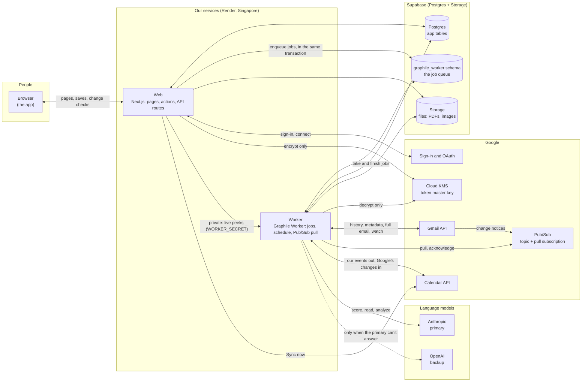

What lives where:

- **Web** serves every screen and runs every save. Slow work goes to the queue rather than running in the request: analysis, Gmail, and the push to Google Calendar. The web encrypts a new mailbox token but can never decrypt one ([decision 0016](decisions/0016-mailbox-tokens-and-key-management.md)).
- **Worker** runs the queued jobs and the schedule, and pulls Gmail's notices from Pub/Sub. It's the only service that can decrypt a mailbox token, so everything that reads Gmail runs here. The web asks it a few live questions through a private endpoint: the subjects shown under Filtered out.
- **Postgres** holds both the app's tables and the queue (`graphile_worker` schema). Enqueueing a job in the same transaction as the row it's about means neither exists without the other ([decision 0014](decisions/0014-hosting-and-job-queue.md)).
- **Models** never get tools and never act. They return an object matching a schema, and a person confirms everything ([decision 0007](decisions/0007-untrusted-message-content.md)).

## A new email, end to end

Gmail doesn't call us. It posts a small notice (the address and a change number, never the email) to our Pub/Sub topic. The worker **pulls** the notice from the subscription. So there's no public address to defend, and notices wait while the worker is down ([decision 0013](decisions/0013-connected-gmail-mailbox.md)).

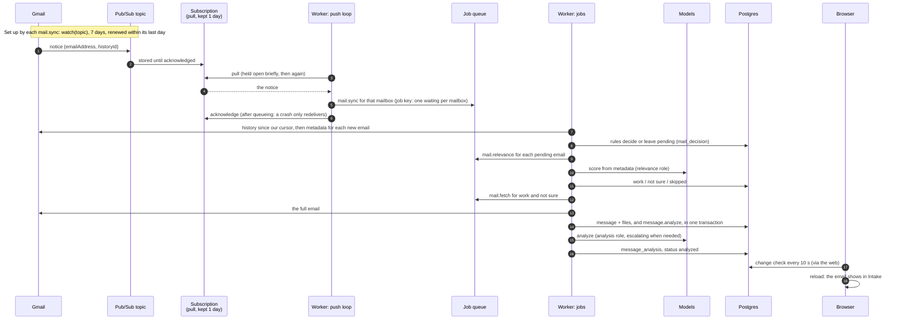

In practice: about 1 s from Gmail to the worker, 20 to 30 s through sync, scoring, fetch and analysis, then up to 10 s until the screen reloads.

**Several workers.** Every worker pulls from the same subscription, and Pub/Sub gives each notice to one of them. Delivery is at least once, so a notice can occasionally arrive twice. A duplicate does nothing:

- the sync's job key replaces a waiting sync instead of adding one;
- the mailbox's own queue runs one sync at a time;
- the cursor finds nothing new the second time;
- `mail_decision` is unique per mailbox and Gmail message.

**Without push** (no `PUBSUB_*` settings, allowed in development only), `mail.reconcile` syncs every mailbox every 2 minutes instead. In production, or with only some of the settings, the worker refuses to start (`lib/mail/push-mode.ts`); its first log line says which mode it runs in. With push, reconcile still runs every 15 minutes as a safety net.

## Paste and upload, end to end

The two ways a person sends a message in themselves: Import offer → Paste an offer, and Import offer → Upload screenshot / PDF (also Today's Upload an offer). **Neither is scored.** The person chose the message, so it's work; scoring is only for what Gmail brings in on its own. Both go straight to the same analysis as an email.

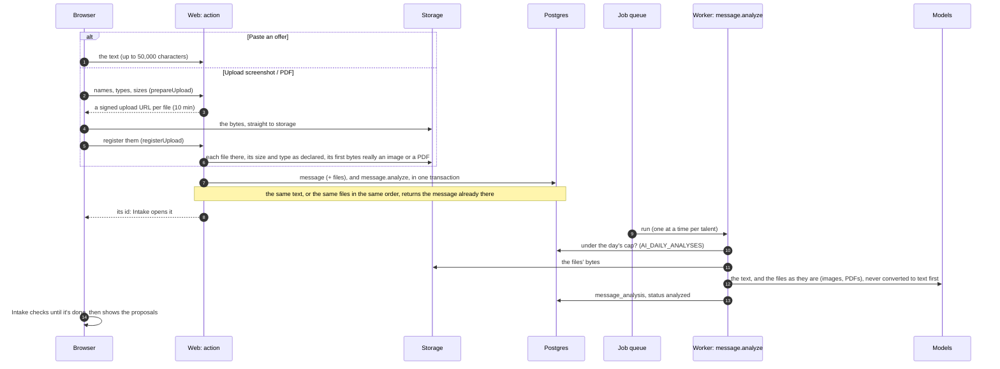

- **Which model** follows the routing below: a PDF or a long text goes to `analysis_complex` at once; screenshots and short text start on `analysis`.
- **Limits** (`lib/uploads.ts`): up to 10 files, 10 MB each, 12 MB together, since files go to the model inline. PNG, JPEG, WebP, and PDF; HEIC/HEIF is refused for now (`docs/tech-debt.md`).
- **Retry** queues the same `message.analyze` again; earlier analyses are kept.

## The job queue and the worker

The queue is Graphile Worker on our own Postgres. A **named queue** runs its jobs one at a time, in order. A **job key** makes a second "do this" replace a waiting one.

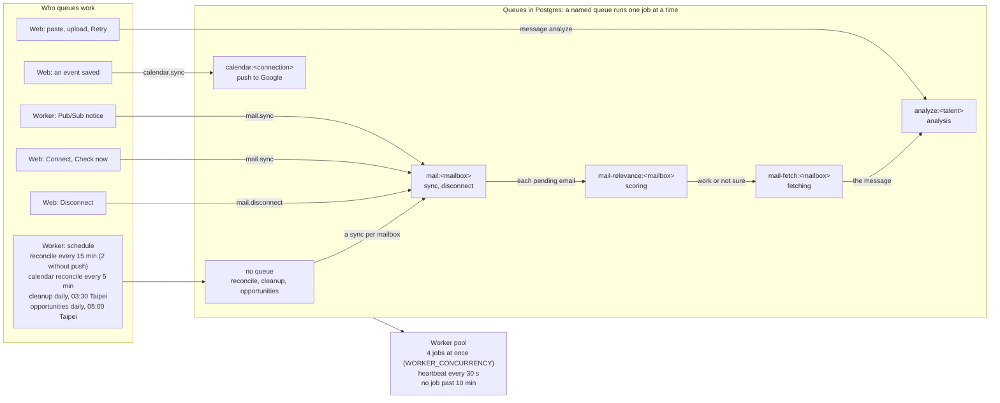

- Scoring has its own queue, apart from syncing, so scoring a month of mail never holds up the next sync.
- Every job must be **safe to run twice**: a job can run again after a crash or a deploy.
- Retries: up to 5 tries for the mail and analysis jobs. A job that gives up is kept 14 days, then cleanup deletes it.
- **Any number of workers** can run at once, including the overlap during a deploy. `npm run dev` starts one, plus the web app. Production plans one to start ([decision 0014](decisions/0014-hosting-and-job-queue.md)).

## Deciding what's work

Most mail never reaches a model, and no email body is read until it's decided as work ([decision 0013](decisions/0013-connected-gmail-mailbox.md)). Only Gmail is sorted this way: a pasted or uploaded message is work because the person sent it in.

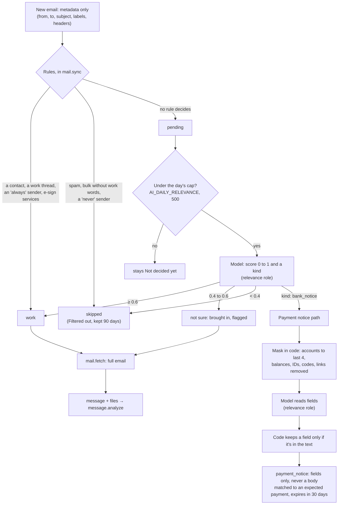

Thresholds come from the relevance eval (`MAIL_RELEVANCE_LOW`, `MAIL_RELEVANCE_HIGH`). An email that tries to steer the check is never decided as work without a person: at most not sure. Your own sent replies come in too: they're analyzed as your side of the deal, and they complete the reply to-do for that thread.

## Where the models come in, and which one answers

Every call goes through one function (`lib/ai/model.ts`). The caller names a **role**; configuration picks the provider and model ([decision 0015](decisions/0015-production-model-providers.md)).

| Role | Used for | Anthropic (primary) | OpenAI (backup) |
|---|---|---|---|
| `relevance` | scoring an email from its metadata; reading a payment notice's fields | `claude-haiku-5-5` | `gpt-6-luna` |
| `analysis` | analyzing a message | `claude-sonnet-5-5` | `gpt-6.1-sol` |
| `analysis_complex` | PDFs, long or unclear messages, contracts | `claude-opus-5-5` | `gpt-6-astra` |

`AI_MODEL_<PROVIDER>_<ROLE>` overrides one, for example `AI_MODEL_ANTHROPIC_ANALYSIS`.

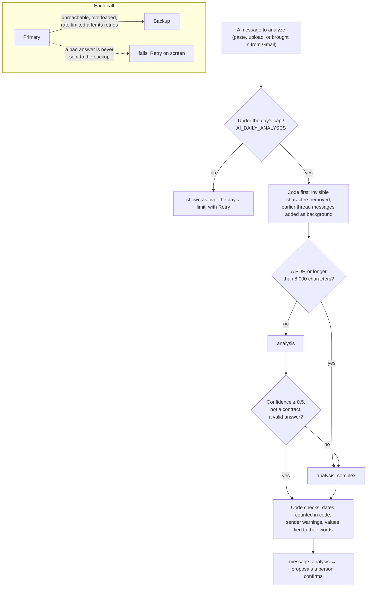

- **Every call is logged** in `ai_call`: role, model, tokens, and for whom, never the content.
- **Only the paid providers**, in development too (decision 0022): nothing goes to a provider that may keep or train on what it's sent.
- **Evals** (`evals/`) run only on made-up cases, capped by `--max-calls` and `--max-cost`.

## Keeping the screen up to date

The worker runs whether anyone is looking or not; the screen only shows what it last loaded. Every screen checks a small **change mark** (`lib/data/changes.ts`): counts and latest timestamps over the talent's tables, one query of about 3 ms. It reloads only when the mark moved.

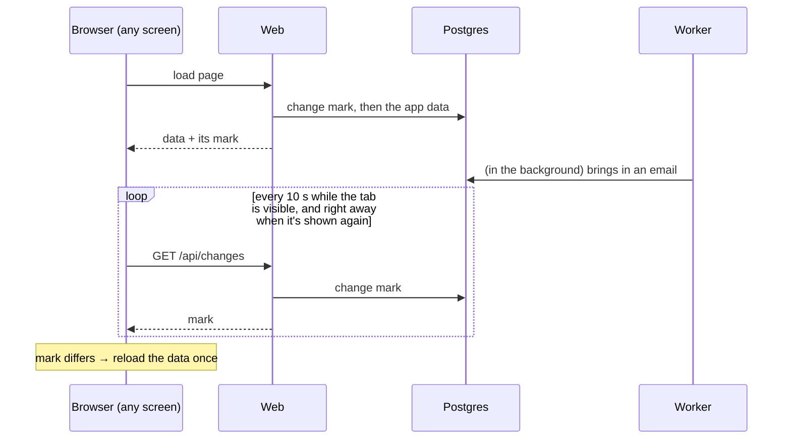

| What | When |
|---|---|
| The change check | every 10 s while visible, and when returning to the tab or window |
| Intake while Check now or sorting runs | every 3 s |
| A message being analyzed | Intake checks until it's done |
| Your own saves | reload at once |

## Google Calendar: today and later

Our events and a dedicated calendar in the person's Google account go both ways ([decision 0017](decisions/0017-two-way-google-calendar.md), design: [calendar-two-way](design/calendar-two-way.md)), and the person's own calendars are shown here read-only. None of it uses Pub/Sub: Calendar's change notices are calls to a public HTTPS address, which we'll have only once deployed, so until then the worker asks every 5 minutes.

### Today

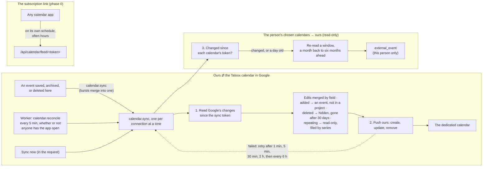

What to know:

- **Nothing is shown about a sync on screen.** A change on either side just appears on the other. Out of sight, the merge keeps both sides' fields, every change is recorded in `audit_log`, and a deleted event is kept 30 days, so a history or Restore can come later.
- **What comes back from Google:** title, date, time, and end, as the same moment in the event's own zone (the workspace's for an event added there; never the zone Google's screen attached); the location where it's a single field (shows, meetings); notes, from below the description's notes line. A travel route, a stay's hotel, and the description's lines above the notes stay ours: an edit to them in Google is put back by the next push.
- **Every connected teammate has their own copy.** A change in anyone's copy comes here, and the others' copies follow at their next sync.
- **A sync token can't be limited to a date window** (Google's rule), so for the chosen calendars it only says *whether* something changed. The window is re-read then, or once a day as it moves on.

### A push, step by step

Connecting asks Google for one narrow permission, `calendar.app.created`: create calendars, and manage events only on calendars this app created. We can't see or change anything else in the account. Reading the person's own calendars (phase 2) asks for two read-only permissions separately, only when they turn it on.

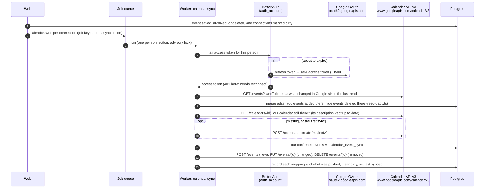

How we talk to Google: plain HTTPS to its REST API (`lib/calendar/google/api.ts`), no SDK, each call with `Authorization: Bearer <access token>` and a 15-second timeout. Better Auth keeps the refresh token encrypted (`BETTER_AUTH_SECRET`) and refreshes the access token when it's about to expire.

| Call | What for | Phase |
|---|---|---|
| `POST /calendars` | create our dedicated calendar | 1 |
| `GET /calendars/{id}`, `PATCH /calendars/{id}` | check it still exists on every push, and keep its description up to date | 1 |
| `GET /calendars/{id}/events?syncToken=…` | what changed in a calendar since the last read: ours read back in full, a chosen one's only to tell whether it changed | 0017 |
| `POST /calendars/{id}/events` | add an event | 1 |
| `PUT /calendars/{id}/events/{eventId}` | replace a changed event (recreated with `POST` if deleted in Google) | 1 |
| `DELETE /calendars/{id}/events/{eventId}` | remove an event deleted, archived, or unconfirmed here | 1 |
| `DELETE /calendars/{id}` | remove our calendar on disconnect, when the person chooses to | 1 |
| `GET /users/me/calendarList` | list the person's calendars to choose from | 2 |
| `GET /calendars/{id}/events?singleEvents=true&timeMin…&timeMax…` | read a chosen calendar's events in the window, repeating events expanded, up to 20 pages of 2,500 | 2 |
| `POST oauth2.googleapis.com/revoke` | withdraw our access on disconnect, when no other workspace's connection uses that Google account | — |

What Google's answer means: 401 is lost access (the connection asks to reconnect); 404 or 410 is a calendar or event gone in Google (recreated); 429, 5xx, or no answer is temporary (retried on the schedule above); anything else waits for the next change or Sync now. Each Google event carries our event's id as a private property, so it can always be traced back. In tests, `GOOGLE_CALENDAR_API_URL` points at a fake Google.

### Later, once deployed

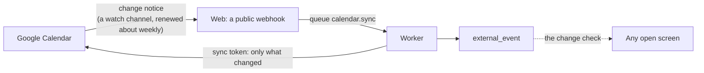

- **Change notices** (`calendar-webhooks`, with or after `deploy-render`): Google tells us when our calendar or a chosen one changes, and the same `calendar.sync` runs within seconds. The 5-minute reconcile becomes a 30-minute safety net, since Google doesn't promise delivery and stores nothing while we're down.

## Contract and quote templates: today and later

A library of fill-in-the-blank contracts and quotes, in English and Traditional Chinese, that people preview, copy, or download as Word files. Templates are data: rows in `document_template` with their Word files in Storage, published on every deploy from the repository's content files, and later edited online ([decision 0020](decisions/0020-document-templates-are-data.md)). None of it calls a model.

### Today

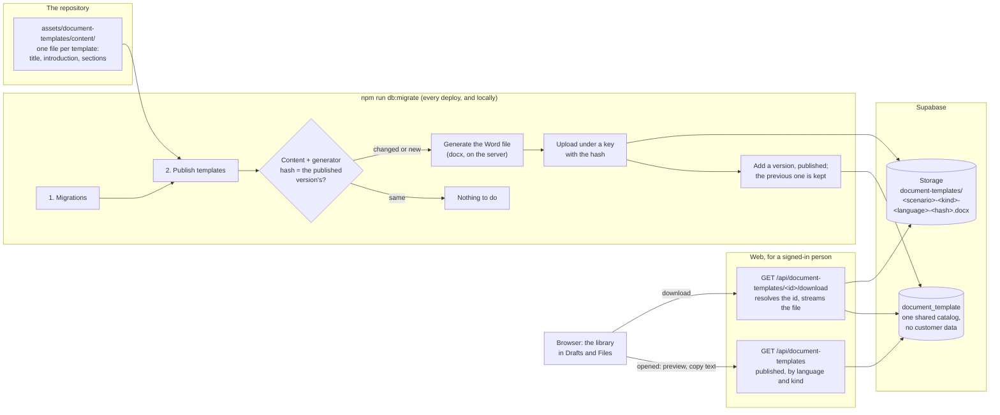

What to know:

- **Nothing loads until the library is opened**, and it's the same for every workspace.
- **A browser never names a Storage key**: it asks for a template by id, and the server streams the file of the published version.
- **Not legal advice, three times:** a line under the library's heading, a note at the top of every Word file, and the terms of service.
- **Changing a template** is a content-file change and a deploy. Changing the generator's layout republishes all of them.

### Later: edited online, and copied into a person's own contract

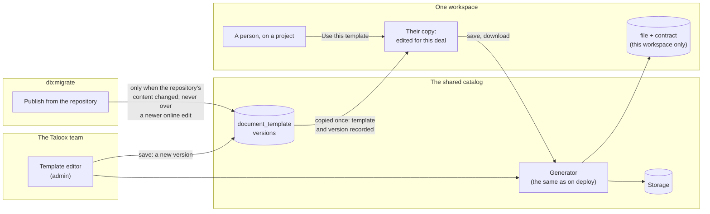

- **An online edit wins over the repository.** A deploy adds a repository version only when the repository's content changed, and leaves it unpublished if a newer edit was made online, for the team to compare.
- **A person's copy is theirs.** It's stored with their workspace's files and a contract version on the project, records which template and version it came from, and editing it never changes the template.

## Opportunities: today and later

Public calls for grants, competitions, and showcases, read once a day into one catalogue shared by every account, screened against each person's profile, and followed as to-dos ([decision 0024](decisions/0024-opportunity-discovery.md)). The catalogue holds only public facts, so it's the one read not scoped to a talent; applications, their to-dos, and the profile are.

### Today

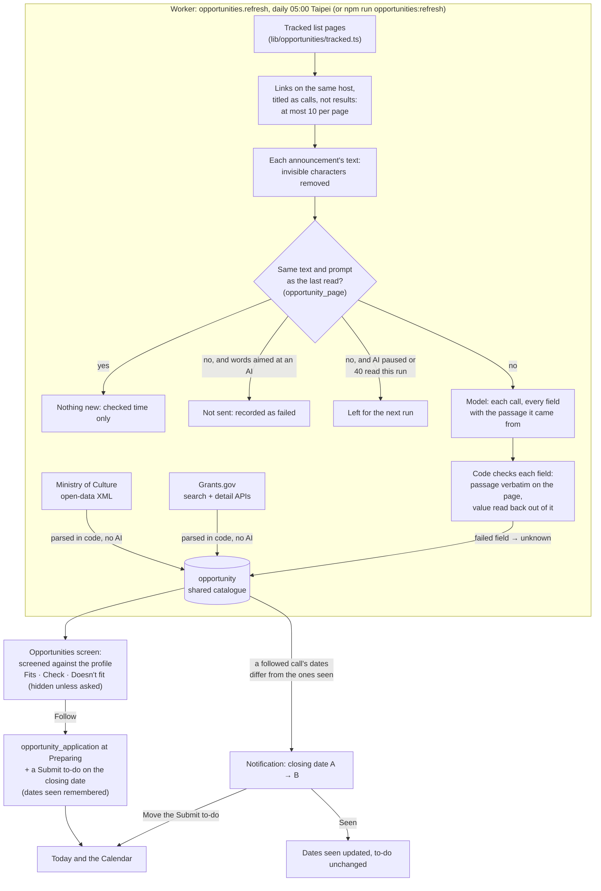

What to know:

- **The model reads only tracked announcements**, and only when their text changed. Everything after the catalogue (screening, following, the notification) is code, and every change to a person's to-dos is a button they press.
- **Screening is a first pass, never a ruling.** Each rule a call states (applicant type, country, county or state, discipline) is a list, "any", or unknown. A stated rule that leaves you out is Doesn't fit; an unknown rule, a profile field left blank, or a source not read in three days is Check. Check is always shown.
- **The dialog shows the evidence and the official link**: the passages a tracked page's fields came from, or the source's own codes.
- **Problems go to the team, not the screen.** The screen shows only when each source was last read. A source that fails, a parser that finds no fields, a structured source giving under half the calls it gave last time, or a tracked page or announcement that can't be read goes to the log and one email per run to `OPS_ALERT_EMAIL` (`lib/opportunities/alert.ts`; on a failed run, only after its last retry).

### The pages we read

| Source | Address | What it gives | How it's read |
|---|---|---|---|
| Ministry of Culture | `grants.moc.gov.tw/OpenData/getOpenData_ApplyList.jsp` | Every open call: year, unit, program, form, start and end date | One XML file, parsed in code. Discipline only for units that fund one. No link per call: the card links to the grants site. |
| Grants.gov | `api.grants.gov` (`search2`, `fetchOpportunity`) | US federal calls, arts category, forecasted or posted | Up to 10 pages of 100, and details for 30 per run, which give applicant types. Mostly for organizations. |
| National Culture and Arts Foundation | `www.ncafroc.org.tw/news.html?categoryId=002` | Its announcements: each regular and special program's call | Tracked page: announcement text from the page body, read by the model. |
| Taipei Department of Cultural Affairs | `culture.gov.taipei/News.aspx?n=63F36AA6E434AD08…` | Its news, including subsidies for the city's residents | Tracked page, as above. "This city" in a call means Taipei. Often has no subsidy on the list. |

### Constraints

- **Fetching:** only these hosts, over HTTPS, no redirects, 20 seconds and 2 MB per request, identified as "Taloox opportunities reader". Nothing a person typed is ever fetched.
- **Per run:** 10 announcements per tracked page, 40 model reads across all of them, 30,000 characters of each announcement, 5 calls per announcement. A call closed more than 30 days ago is dropped.
- **AI:** through `lib/ai/model.ts`, so it stops while AI is paused or the day's spend cap is reached (decision 0008), and an announcement not read is read the next day. A changed announcement costs one model call: about $0.01.
- **Not read:** PDFs and other attachments, where most of NCAF's eligibility rules are, so those fields are mostly Check.
- **Adding a page is a code change**: an entry in `tracked.ts` with which links are announcements and where the text sits on the page. A site that changes its markup stops yielding links: the page is recorded as failed, and the team is told.

### Assumptions

- **A list that leaves a call out hasn't withdrawn it.** A call is kept until its source says otherwise; only a re-read announcement that no longer gives a call removes it, and never one someone follows.
- **An announcement's title says whether it's a call.** Titles are matched against each page's words for a call, and lists of results are skipped. A call with an unusual title is missed.
- **The list page puts the newest first**, so the first 10 are the ones that matter.
- **A date whose passage checks out is in the right field.** The check catches an invented date, not a real one misplaced, such as an announcement date read as the closing date. That's why the official page is one click away.
- **Dates are the source region's:** Taipei for Taiwan, New York for the US.
- **The profile is what the person says about themselves**, and nothing checks it.

### Later

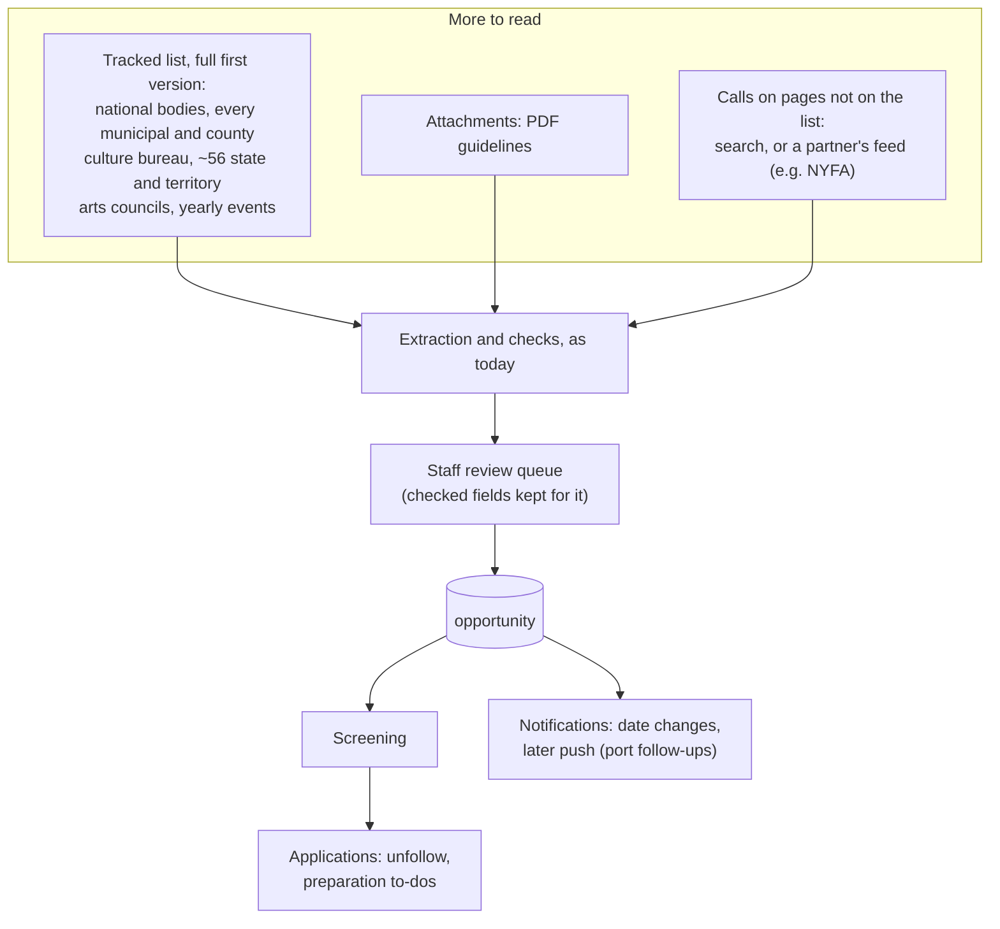

| | Today | Later |
|---|---|---|
| Coverage | 2 structured sources, 2 tracked pages | The full tracked list in decision 0024, kept current as ongoing work |
| Yearly events (Golden Melody Awards, SXSW) | Not covered | Tracked pages, read like any other |
| Eligibility in attachments | Not read, so Check | PDF guidelines read and checked the same way |
| Before publishing | Code checks only | A staff review queue in front of publishing |
| Calls off the list | Not found | Search, or a partner's feed |
| A tracked call with no date that drops off its list | Stays, as Check the official page | Cleaned up |
| A tracked page whose titles stop matching | Missed without an error | Listed for a person in the review queue |
| Following | Follow, stages, to-dos, link to a project | Unfollow; preparation to-dos when preparation is designed |
| What's announced | A followed call's dates changing | Push notifications, with the port follow-ups |

## Recovery paths

| Something fails | What happens |
|---|---|
| The worker stops | Notices wait in Pub/Sub for 1 day. Jobs wait in Postgres. On restart, everything carries on, and reconcile catches up. |
| A worker dies holding a job | It stops beating. After 2 minutes any worker releases its locks, and the job runs again. |
| A job hangs | It fails at 10 minutes and retries, so its queue isn't held. |
| A Pub/Sub notice is lost or late | `mail.reconcile` syncs every mailbox every 15 minutes. |
| The Gmail watch lapses | Any sync within its last day renews it; reconcile makes sure syncs happen. |
| Pub/Sub is unreachable | The pull loop waits longer each time, up to a minute. Reconcile keeps mail coming. |
| Gmail unreachable or rate-limited | `mail.sync` retries 5 times, then the connection shows an error until Check now. |
| The primary model is down or busy | The backup answers. If both fail, an analysis shows the failure with Retry; scoring retries up to 5 times, then the email stays Not decided yet. |
| The model gives a bad answer | Analysis asks the large model once; if that fails too, it shows the failure with Retry. Scoring retries, then stays Not decided yet. |
| Google Calendar push fails | Retries after 1 min, 5 min, 30 min, 2 h, then every 6 h. Lost access waits for Reconnect. |
| A mailbox's access is revoked | The connection asks to reconnect; nothing more is read. |
| An opportunity source fails or changes its format | It keeps what it had and records why; the team gets an email (`OPS_ALERT_EMAIL`), and the screen shows nothing but the last read. A tracked page fails on its own; the source fails only when every page does. Retried up to 3 times. |
| The day's AI cap is reached | An analysis shows it's over the limit, with Retry. Scoring leaves the email Not decided yet for a later check. Nothing is dropped. |

## Timings at a glance

| What | Interval |
|---|---|
| Gmail notice → worker | about 1 s (push) |
| Reconcile | 15 min with push, 2 min without |
| Gmail watch | 7 days, renewed within its last day |
| Notices kept in Pub/Sub | 1 day |
| Worker heartbeat / lock release | 30 s / after 2 min silent |
| Job time limit | 10 min |
| Screen change check | 10 s, and on returning to the tab |
| Intake during Check now or sorting | 3 s |
| Calendar push retries | 1 min, 5 min, 30 min, 2 h, then 6 h |
| Google Calendar read back (our calendar and the chosen ones) | every 5 min (`calendar.reconcile`; every minute in development); a chosen calendar's window re-read when it changed, or daily |
| Opportunities read | daily at 05:00 Taipei; a call not read in 3 days shows as Check |
| Cleanup | daily at 03:30 Taipei: skipped mail after 90 days, payment notices and events deleted in Google after 30, given-up jobs after 14 |
