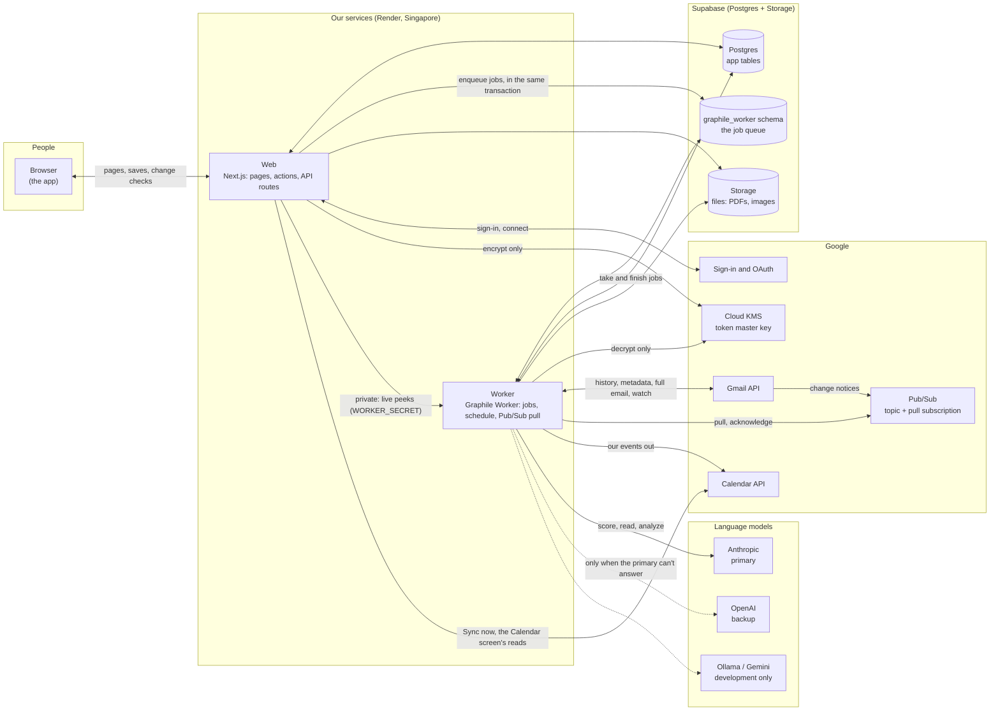
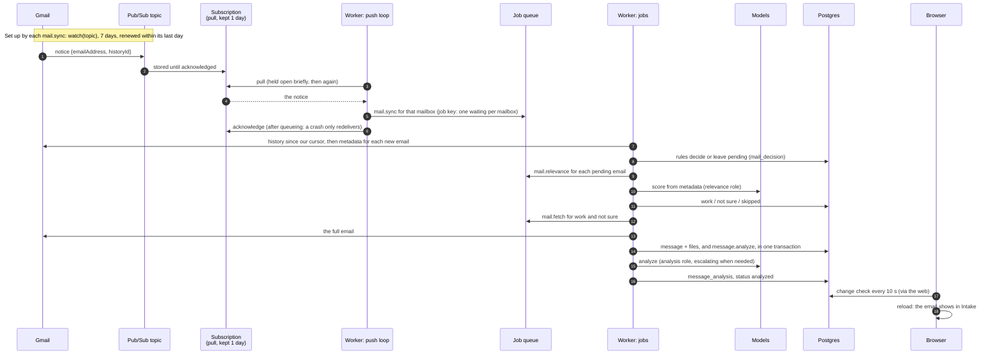
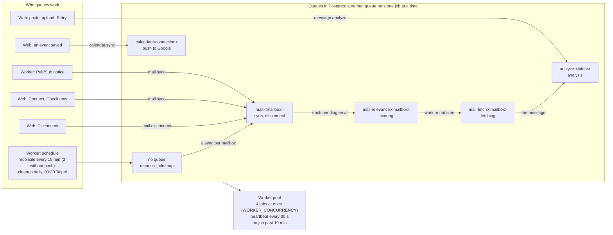
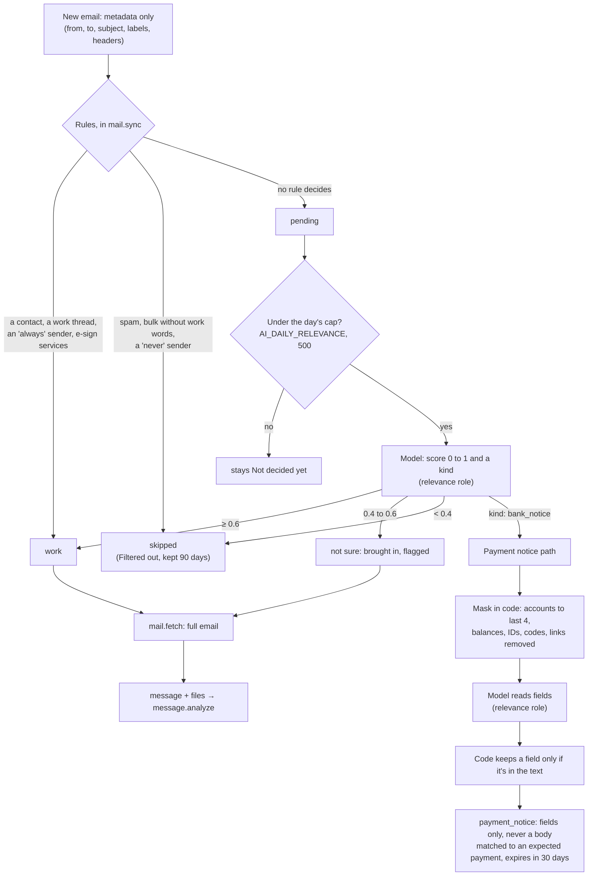
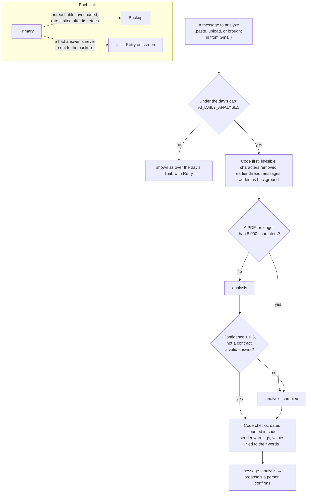
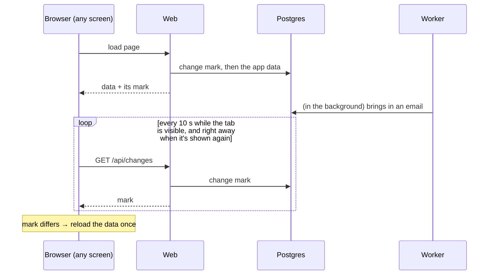
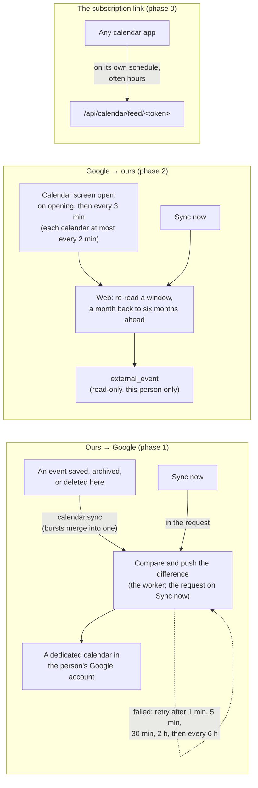
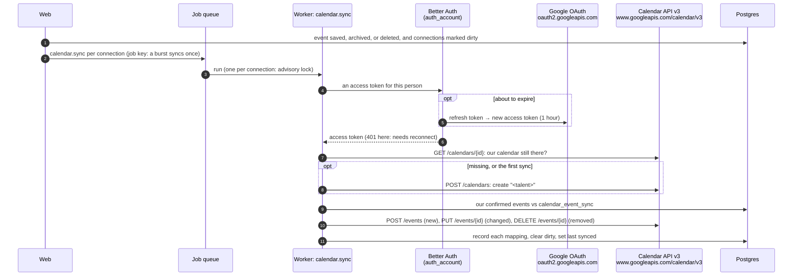
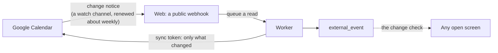

# System map

How the running pieces connect: the web app, the worker, the database and its job queue, Google's services, and the language models. One picture of the whole first, then one per part. For the why behind each choice, follow the decision links. For the data model, see [architecture.md](architecture.md). This page describes the code as of October 2026. If they disagree, the code wins: fix this page.

- [The big picture](#the-big-picture)
- [A new email, end to end](#a-new-email-end-to-end)
- [The job queue and the worker](#the-job-queue-and-the-worker)
- [Deciding what's work](#deciding-whats-work)
- [Where the models come in, and which one answers](#where-the-models-come-in-and-which-one-answers)
- [Keeping the screen up to date](#keeping-the-screen-up-to-date)
- [Google Calendar: today and later](#google-calendar-today-and-later)
- [Recovery paths](#recovery-paths)
- [Timings at a glance](#timings-at-a-glance)

## The big picture

What lives where:

- **Web** serves every screen and runs every save. Slow work goes to the queue rather than running in the request: analysis, Gmail, and the push to Google Calendar. The web encrypts a new mailbox token but can never decrypt one ([decision 0016](decisions/0016-mailbox-tokens-and-key-management.md)).
- **Worker** runs the queued jobs and the schedule, and pulls Gmail's notices from Pub/Sub. It's the only service that can decrypt a mailbox token, so everything that reads Gmail runs here. The web asks it a few live questions through a private endpoint: the subjects shown under Filtered out.
- **Postgres** holds both the app's tables and the queue (`graphile_worker` schema). Enqueueing a job in the same transaction as the row it's about means neither exists without the other ([decision 0014](decisions/0014-hosting-and-job-queue.md)).
- **Models** never get tools and never act. They return an object matching a schema, and a person confirms everything ([decision 0007](decisions/0007-untrusted-message-content.md)).

## A new email, end to end

Gmail doesn't call us. It posts a small notice (the address and a change number, never the email) to our Pub/Sub topic. The worker **pulls** the notice from the subscription. So there's no public address to defend, and notices wait while the worker is down ([decision 0013](decisions/0013-connected-gmail-mailbox.md)).

In practice: about 1 s from Gmail to the worker, 20 to 30 s through sync, scoring, fetch and analysis, then up to 10 s until the screen reloads.

**Several workers.** Every worker pulls from the same subscription, and Pub/Sub gives each notice to one of them. Delivery is at least once, so a notice can occasionally arrive twice. A duplicate does nothing:

- the sync's job key replaces a waiting sync instead of adding one;
- the mailbox's own queue runs one sync at a time;
- the cursor finds nothing new the second time;
- `mail_decision` is unique per mailbox and Gmail message.

**Without push** (no `PUBSUB_*` settings, allowed in development only), `mail.reconcile` syncs every mailbox every 2 minutes instead. In production, or with only some of the settings, the worker refuses to start (`lib/mail/push-mode.ts`); its first log line says which mode it runs in. With push, reconcile still runs every 15 minutes as a safety net.

## The job queue and the worker

The queue is Graphile Worker on our own Postgres. A **named queue** runs its jobs one at a time, in order. A **job key** makes a second "do this" replace a waiting one.

- Scoring has its own queue, apart from syncing, so scoring a month of mail never holds up the next sync.
- Every job must be **safe to run twice**: a job can run again after a crash or a deploy.
- Retries: up to 5 tries for the mail and analysis jobs. A job that gives up is kept 14 days, then cleanup deletes it.
- **Any number of workers** can run at once, including the overlap during a deploy. `npm run dev` starts one, plus the web app. Production plans one to start ([decision 0014](decisions/0014-hosting-and-job-queue.md)).

## Deciding what's work

Most mail never reaches a model, and no email body is read until it's decided as work ([decision 0013](decisions/0013-connected-gmail-mailbox.md)).

Thresholds come from the relevance eval (`MAIL_RELEVANCE_LOW`, `MAIL_RELEVANCE_HIGH`). An email that tries to steer the check is never decided as work without a person: at most not sure. Your own sent replies come in too: they're analyzed as your side of the deal, and they complete the reply to-do for that thread.

## Where the models come in, and which one answers

Every call goes through one function (`lib/ai/model.ts`). The caller names a **role**; configuration picks the provider and model ([decision 0015](decisions/0015-production-model-providers.md)).

| Role | Used for | Anthropic (primary) | OpenAI (backup) |
|---|---|---|---|
| `relevance` | scoring an email from its metadata; reading a payment notice's fields | `claude-haiku-5-5` | `gpt-6-luna` |
| `analysis` | analyzing a message | `claude-sonnet-5-5` | `gpt-6.1-sol` |
| `analysis_complex` | PDFs, long or unclear messages, contracts | `claude-opus-5-5` | `gpt-6-astra` |

`AI_MODEL_<PROVIDER>_<ROLE>` overrides one, for example `AI_MODEL_ANTHROPIC_ANALYSIS`.

- **Every call is logged** in `ai_call`: role, model, tokens, and for whom, never the content.
- **Real mail in development** goes only to a provider that doesn't keep data, or to a local model (`AI_MAILBOX_PROVIDER=ollama`), never to a free tier that keeps what it's sent (`AI_PROVIDER_KEEPS_DATA`).
- **Evals** (`evals/`) run only on made-up cases, capped by `--max-calls` and `--max-cost`.

## Keeping the screen up to date

The worker runs whether anyone is looking or not; the screen only shows what it last loaded. Every screen checks a small **change mark** (`lib/data/changes.ts`): counts and latest timestamps over the talent's tables, one query of about 3 ms. It reloads only when the mark moved.

| What | When |
|---|---|
| The change check | every 10 s while visible, and when returning to the tab or window |
| Intake while Check now or sorting runs | every 3 s |
| A message being analyzed | Intake checks until it's done |
| Your own saves | reload at once |

## Google Calendar: today and later

Two directions, and neither uses Pub/Sub. Calendar's change notices are calls to a public HTTPS address, which we'll have only once deployed ([decision 0009](decisions/0009-google-calendar-sync.md)).

### Today

The current limits:

- Changes made in Google show here only while someone has the Calendar screen open.
- An event edited or deleted in Google, on our dedicated calendar, is put back by the next push.

### A push, step by step

Connecting asks Google for one narrow permission, `calendar.app.created`: create calendars, and manage events only on calendars this app created. We can't see or change anything else in the account. Reading the person's own calendars (phase 2) asks for two read-only permissions separately, only when they turn it on.

How we talk to Google: plain HTTPS to its REST API (`lib/calendar/google/api.ts`), no SDK, each call with `Authorization: Bearer <access token>` and a 15-second timeout. Better Auth keeps the refresh token encrypted (`BETTER_AUTH_SECRET`) and refreshes the access token when it's about to expire.

| Call | What for | Phase |
|---|---|---|
| `POST /calendars` | create our dedicated calendar | 1 |
| `GET /calendars/{id}` | check it still exists, on every push | 1 |
| `POST /calendars/{id}/events` | add an event | 1 |
| `PUT /calendars/{id}/events/{eventId}` | replace a changed event (recreated with `POST` if deleted in Google) | 1 |
| `DELETE /calendars/{id}/events/{eventId}` | remove an event deleted, archived, or unconfirmed here | 1 |
| `DELETE /calendars/{id}` | remove our calendar on disconnect, when the person chooses to | 1 |
| `GET /users/me/calendarList` | list the person's calendars to choose from | 2 |
| `GET /calendars/{id}/events?singleEvents=true&timeMin…&timeMax…` | read a chosen calendar's events in the window, repeating events expanded, up to 20 pages of 2,500 | 2 |
| `POST oauth2.googleapis.com/revoke` | withdraw our access on disconnect, when no other workspace's connection uses that Google account | — |

What Google's answer means: 401 is lost access (the connection asks to reconnect); 404 or 410 is a calendar or event gone in Google (recreated); 429, 5xx, or no answer is temporary (retried on the schedule above); anything else waits for the next change or Sync now. Each Google event carries our event's id as a private property, so it can always be traced back. In tests, `GOOGLE_CALENDAR_API_URL` points at a fake Google.

### Why it isn't two-way yet

Two separate gaps; only one of them is about a public address.

| What | Today | What it waits for |
|---|---|---|
| The person's own Google calendars shown here (Google → ours, read-only) | Works, by polling while the Calendar screen is open | A public HTTPS address (after deploy) only lets Google tell us about changes instead of us asking. |
| Edits made in Google to our events coming back (true two-way) | Not built: the next push puts our version back | A product decision, not the network: what an edit in Google means for project data, asked before changing it. Phase 3, only if people turn out to edit project events in Google ([decision 0009](decisions/0009-google-calendar-sync.md)). |

### Later, once deployed

- **Phase 2, finished:** Google tells us when a chosen calendar changes. The worker reads only what changed, using Google's sync token, in the background, whether or not anyone has the screen open.
- **Phase 3, only if people edit project events in Google:** edits made there come back here, and ask before changing project data.

## Recovery paths

| Something fails | What happens |
|---|---|
| The worker stops | Notices wait in Pub/Sub for 1 day. Jobs wait in Postgres. On restart, everything carries on, and reconcile catches up. |
| A worker dies holding a job | It stops beating. After 2 minutes any worker releases its locks, and the job runs again. |
| A job hangs | It fails at 10 minutes and retries, so its queue isn't held. |
| A Pub/Sub notice is lost or late | `mail.reconcile` syncs every mailbox every 15 minutes. |
| The Gmail watch lapses | Any sync within its last day renews it; reconcile makes sure syncs happen. |
| Pub/Sub is unreachable | The pull loop waits longer each time, up to a minute. Reconcile keeps mail coming. |
| Gmail unreachable or rate-limited | `mail.sync` retries 5 times, then the connection shows an error until Check now. |
| The primary model is down or busy | The backup answers. If both fail, an analysis shows the failure with Retry; scoring retries up to 5 times, then the email stays Not decided yet. |
| The model gives a bad answer | Analysis asks the large model once; if that fails too, it shows the failure with Retry. Scoring retries, then stays Not decided yet. |
| Google Calendar push fails | Retries after 1 min, 5 min, 30 min, 2 h, then every 6 h. Lost access waits for Reconnect. |
| A mailbox's access is revoked | The connection asks to reconnect; nothing more is read. |
| The day's AI cap is reached | An analysis shows it's over the limit, with Retry. Scoring leaves the email Not decided yet for a later check. Nothing is dropped. |

## Timings at a glance

| What | Interval |
|---|---|
| Gmail notice → worker | about 1 s (push) |
| Reconcile | 15 min with push, 2 min without |
| Gmail watch | 7 days, renewed within its last day |
| Notices kept in Pub/Sub | 1 day |
| Worker heartbeat / lock release | 30 s / after 2 min silent |
| Job time limit | 10 min |
| Screen change check | 10 s, and on returning to the tab |
| Intake during Check now or sorting | 3 s |
| Calendar push retries | 1 min, 5 min, 30 min, 2 h, then 6 h |
| Calendar import while open | every 3 min (each calendar at most every 2 min) |
| Cleanup | daily at 03:30 Taipei: skipped mail after 90 days, payment notices after 30, given-up jobs after 14 |
